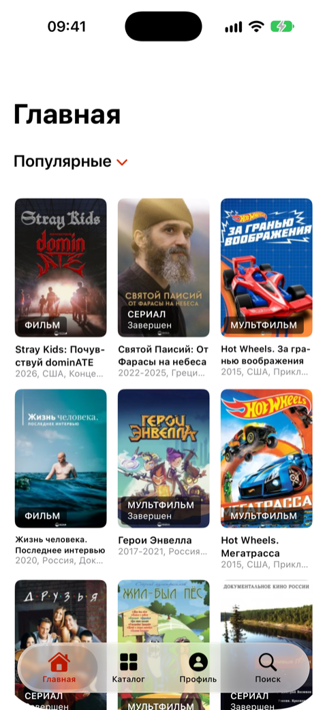
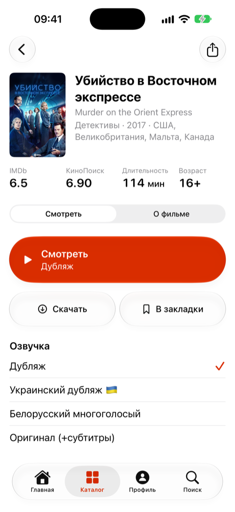
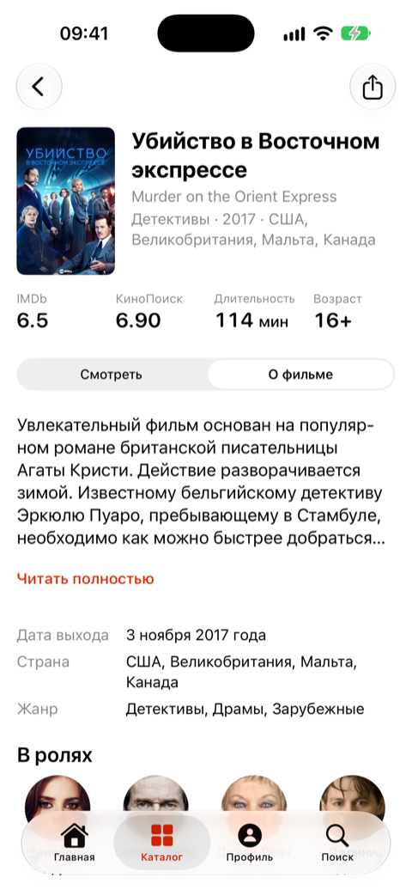
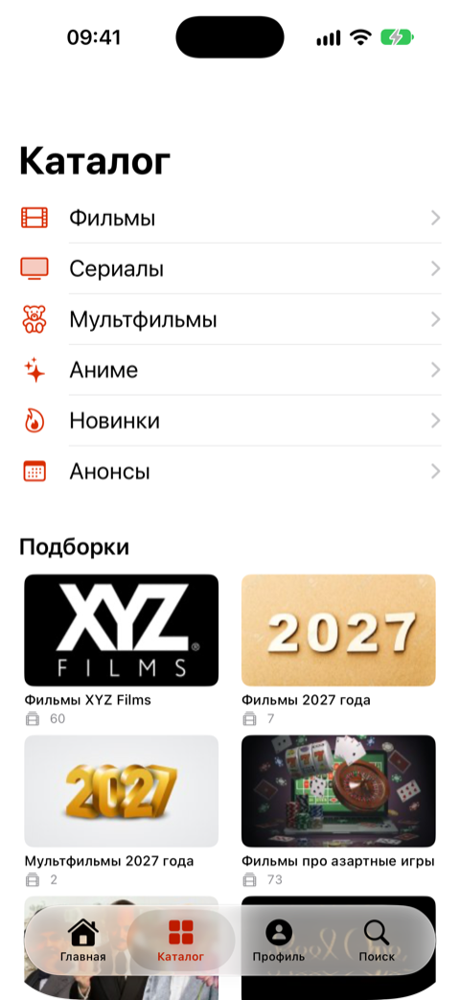
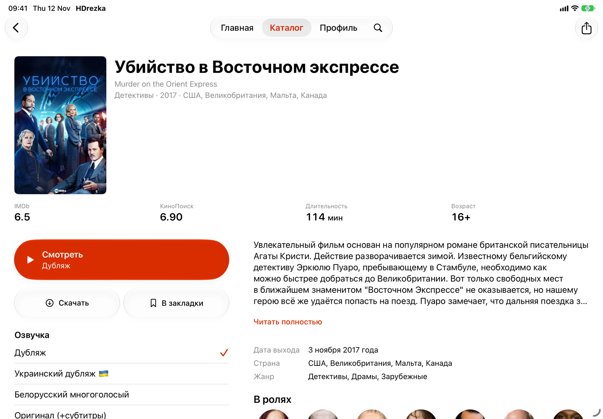

<p align="center">
  <picture>
    <source media="(prefers-color-scheme: dark)" srcset="docs/icon-dark.png">
    
  </picture>
</p>

<h1 align="center">HDrezka для iOS</h1>

<p align="center">
  Нативный клиент HDRezka для iPhone и iPad на SwiftUI.<br>
  Каталог, страница фильма, плеер и загрузки — без трекинга, с Liquid Glass на iOS 26.
</p>

<p align="center">
  <a href="https://github.com/eldiablo-1226/hd-rezka/releases/latest"></a>
  <a href="https://github.com/eldiablo-1226/hd-rezka/actions/workflows/release-ipa.yml"></a>
  
</p>

<p align="center">
  <picture>
    <source media="(prefers-color-scheme: dark)" srcset="docs/screenshots/iphone-home-dark.png">
    
  </picture>
  <picture>
    <source media="(prefers-color-scheme: dark)" srcset="docs/screenshots/iphone-watch-dark.png">
    
  </picture>
  <picture>
    <source media="(prefers-color-scheme: dark)" srcset="docs/screenshots/iphone-about-dark.png">
    
  </picture>
  <picture>
    <source media="(prefers-color-scheme: dark)" srcset="docs/screenshots/iphone-catalog-dark.png">
    
  </picture>
  <br>
  <sub>Главная · страница фильма: «Смотреть» и «О фильме» · каталог</sub>
</p>

<p align="center">
  <picture>
    <source media="(prefers-color-scheme: dark)" srcset="docs/screenshots/ipad-details-dark.png">
    
  </picture>
  <br>
  <sub>На iPad обе половины страницы фильма стоят рядом</sub>
</p>

## Возможности

- **Каталог.** «Последние поступления», «Популярные», «Сейчас смотрят» и «Ожидается» на главной. Вкладка «Каталог» повторяет меню сайта: фильмы, сериалы, мультфильмы и аниме по жанрам и студиям, лучшие за любой год, новинки, анонсы и подборки. И поиск. Ряд «Продолжить просмотр» начинает с того места, где вы остановились.
- **Страница фильма.** В шапке рейтинги IMDb и КиноПоиска, длительность и возраст. Ниже два режима: «Смотреть» — озвучки с флагами, сезоны, серии и качество; «О фильме» — описание, актёры и трейлер.
- **Плеер.** Системный плеер с «картинкой в картинке», автовоспроизведением следующей серии и запоминанием качества. Видео можно открывать в Infuse.
- **Загрузки.** Фильмы и серии для просмотра без сети, с паузой и продолжением.
- **Аккаунт.** Вход, закладки по категориям сайта, «Досмотреть», обновления сериалов, статус Premium.
- **Зеркала.** Девять проверенных зеркал сайта и свой адрес, если их заблокируют.
- **Без трекинга.** Firebase и аналитика оригинального приложения удалены.
- **Интерфейс.** Системные компоненты, тёмная тема, крупный шрифт, iPad; русский, украинский и английский языки.

## Установка

1. Скачайте [HDrezka.ipa](https://github.com/eldiablo-1226/hd-rezka/releases/latest/download/HDrezka.ipa) из [последнего релиза](https://github.com/eldiablo-1226/hd-rezka/releases/latest).
2. Установите его через [AltStore](https://altstore.io), [SideStore](https://sidestore.io), [Sideloadly](https://sideloadly.io) или [TrollStore](https://github.com/opa334/TrollStore). IPA не подписан: эти программы подписывают его при установке. С бесплатным Apple ID подпись действует 7 дней, AltStore и SideStore продлевают её сами.
3. Если сайт не открывается, выберите другое зеркало: «Настройки» → «Зеркало сайта».

Каждый релиз собирает [GitHub Actions](https://github.com/eldiablo-1226/hd-rezka/actions/workflows/release-ipa.yml) из этого репозитория, когда в `main` меняется приложение. В описании релиза указан коммит, из которого он собран.

## Сборка из исходников

Нужны macOS с Xcode 27.2 и [XcodeGen](https://github.com/yonaskolb/XcodeGen).

```bash
brew install xcodegen
git clone https://github.com/eldiablo-1226/hd-rezka.git
cd hd-rezka/app
./regen.sh               # создаёт HDrezka.xcodeproj и кладёт в него Package.resolved
open HDrezka.xcodeproj
```

- `./build-ipa.sh` собирает IPA без подписи в `.build/ipa/HDrezka.ipa`, так же как CI.
- `SIM_ID=<UDID симулятора> ./build.sh dev test` запускает тесты.

Зависимости подключены через Swift Package Manager: Alamofire, SwiftSoup, Nuke, YouTubePlayerKit, AlertKit и SwiftUI-Flow. Версии закреплены в `app/Package.resolved`. Alamofire 5.8.0 и SwiftSoup 2.6.1 закреплены намеренно: с более новыми версиями парсер страниц сайта ведёт себя иначе.

## Что где лежит

| Путь | Что там |
| --- | --- |
| [`app/`](app) | приложение: исходники SwiftUI, тесты, `project.yml` для XcodeGen |
| [`re/`](re) | заметки и инструменты восстановления, план улучшений ([`IMPROVEMENTS.md`](re/IMPROVEMENTS.md)) |
| [`DESIGN.md`](DESIGN.md) | дизайн-система: цвета, шрифты, компоненты |
| [`PRODUCT.md`](PRODUCT.md) | для кого приложение и что в нём главное |
| [`.github/workflows/release-ipa.yml`](.github/workflows/release-ipa.yml) | сборка IPA и публикация релиза |

## Откуда этот код

Исходники HDRezka 1.6.0 (сборка 570) никогда не публиковались. Этот код восстановлен из IPA: поведение, разметка и сетевые запросы сверены с бинарником, а заметки об этом лежат в [`re/RECONSTRUCTION.md`](re/RECONSTRUCTION.md). Затем приложение доработано: удалены Firebase и аналитика, страница фильма собрана заново на системных компонентах, исправлены воспроизведение и загрузки, добавлен список проверенных зеркал.

> [!NOTE]
> Это неофициальный клиент: проект не связан с HDRezka. Фильмы и сериалы показывает выбранное зеркало сайта, права на них принадлежат их владельцам.
